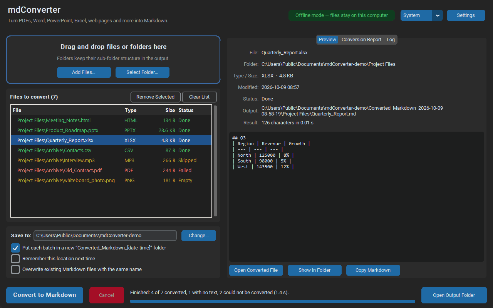
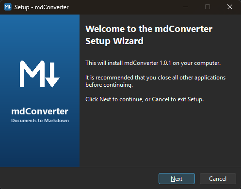
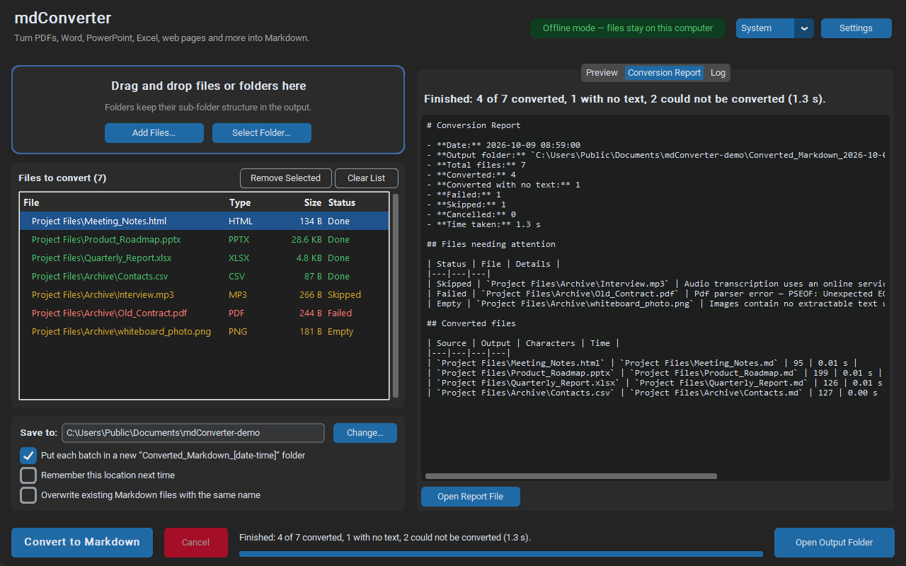

# mdConverter

[](https://github.com/jordanbrais1-hub/mdConverter/actions/workflows/ci.yml)


A desktop app that converts PDFs, Word, PowerPoint, Excel, web pages and more into clean **Markdown**. It's built for people who don't use the command line: drag files in, click **Convert**, and open the results.

Conversion is handled by Microsoft's [MarkItDown](https://github.com/microsoft/markitdown) library. mdConverter adds a friendly interface, batch processing, folder-structure mirroring and a conversion report on top of it.



## Download

**[⬇ Download the latest version for Windows](https://github.com/jordanbrais1-hub/mdConverter/releases/latest)**

1. Under **Assets**, download **`mdConverter-Setup-….exe`**.
2. Run it and click through the setup (Next → Next → Finish). No administrator rights or Python needed.
3. Open **mdConverter** from the Start menu or the desktop shortcut.

If Windows shows *"Windows protected your PC"*, click **More info → Run anyway**. The installer isn't code-signed, so SmartScreen warns about it. You can uninstall from *Settings → Apps*. A **portable zip** is also attached to each release if you'd rather not install.



## Features

- **Drag and drop** files or whole folders anywhere on the window, or use **Add Files…** / **Select Folder…**.
- **Batch conversion** on a background thread, with a live progress bar and per-file status. The UI never freezes, and you can cancel at any time.
- **Mirrors folder structure.** Importing `Project Files/Archive/…` produces the same sub-folders in the output.
- **Organised output.** Each batch can go into its own `Converted_Markdown_YYYY-MM-DD_HH-MM-SS` folder. You can also pick a fixed destination and have the app remember it.
- **Preview pane** shows the generated Markdown next to the file's details (size, dates, output path, character count, conversion time).
- **One-click actions:** Open Output Folder, Open Converted File, Show in Folder, Copy Markdown.
- **Conversion report.** Unsupported or broken files don't crash the app. They are listed with a clear reason in the *Conversion Report* tab and in `Conversion_Report.md` in the output folder.
- **Offline by default.** Nothing leaves your computer unless you turn on an online feature in Settings (see [Privacy](#privacy--network-use)).
- Light, dark and system themes. Settings persist between sessions.
- Ships as a Windows installer (Inno Setup) with Start-menu and desktop shortcuts and a clean uninstaller. The installer follows the system's light/dark theme and adapts to English or Spanish.



## Supported formats

| Category | Extensions | Notes |
|---|---|---|
| Documents | `.pdf` `.docx` `.pptx` `.xlsx` `.xls` `.epub` `.msg` `.ipynb` | PDF text extraction only; scanned PDFs have no text layer |
| Web & data | `.html` `.htm` `.xml` `.rss` `.atom` `.csv` `.json` `.jsonl` `.txt` `.md` | |
| Images | `.jpg` `.jpeg` `.png` | Text and descriptions need an AI vision model (Settings) |
| Audio | `.mp3` `.wav` `.m4a` `.mp4` | Speech-to-text uses an online service (opt-in) |
| Archives | `.zip` | Each file inside is converted |

## Getting started (from source)

Requires **Python 3.11+** on Windows, macOS or Linux.

```powershell
git clone https://github.com/jordanbrais1-hub/mdConverter.git
cd mdConverter
python -m venv .venv
.venv\Scripts\activate          # macOS/Linux: source .venv/bin/activate
pip install -r requirements.txt
python main.py
```

> On Linux, Tkinter may need the system package (for example `sudo apt install python3-tk`).

## Building the Windows app and installer

```powershell
winget install JRSoftware.InnoSetup   # one-time: installer compiler (6.6 or newer)
build.bat
```

The script creates a virtual environment, installs dependencies and runs PyInstaller with [`mdConverter.spec`](mdConverter.spec). It then compiles the Inno Setup script [`installer/mdConverter.iss`](installer/mdConverter.iss):

```
dist\mdConverter\mdConverter.exe            the app (one-folder build)
dist\mdConverter-Setup-<version>.exe         the installer to share
```

If Inno Setup isn't installed, only the app folder is built. That folder must stay together because the `.exe` needs the `_internal` folder beside it. The spec builds in *one-folder* mode on purpose: it starts much faster than `--onefile`, which has to unpack ~200 MB of parsers to a temp folder on every launch.

Each push to `main` also builds the executable in GitHub Actions and attaches it to the run as a downloadable artifact.

### Publishing a release

Bump `__version__` in [`mdconverter/__init__.py`](mdconverter/__init__.py), commit, then push a matching tag. GitHub Actions tests, builds and publishes a release with the installer and a portable zip attached ([`release.yml`](.github/workflows/release.yml)):

```powershell
git tag v1.1.0
git push origin v1.1.0
```

To build by hand:

```powershell
pip install -r requirements.txt
pyinstaller --noconfirm --clean mdConverter.spec
```

## Using the app

1. **Add files.** Drag files or folders onto the window, or click **Add Files…** / **Select Folder…**.
2. **Choose where to save.** By default a new `Converted_Markdown_[date-time]` folder is created in *Documents*. Click **Change…** to choose another place. Tick *Remember this location* to keep it next time.
3. Click **Convert to Markdown**.
4. Click any file in the list to preview its Markdown. Use **Open Output Folder** to see all results.
5. If anything couldn't be converted, the **Conversion Report** tab explains why.

## Privacy & network use

mdConverter converts everything **locally** by default. The badge in the top-right corner always shows the current mode.

Two optional features need the internet. Both are off until you enable them in **Settings**:

| Feature | What is sent | Why |
|---|---|---|
| **AI vision model** | Images, and images inside documents, go to the OpenAI-compatible endpoint you configure | Describes images and reads text in them |
| **Online audio transcription** | Audio goes to Google's web speech API (MarkItDown's built-in transcriber) | Converts speech to text |

When audio transcription is off, audio files are skipped. MarkItDown's audio converter is also unregistered, so audio inside `.zip` archives is never uploaded. MarkItDown plugins are disabled, so no third-party code is loaded implicitly.

For the AI model you can use OpenAI, Azure OpenAI, or any OpenAI-compatible server, including local ones such as Ollama or LM Studio (set *API endpoint*, for example `http://localhost:11434/v1`). If *API key* is left blank, the `OPENAI_API_KEY` environment variable is used.

## Project structure

```
mdConverter/
├── main.py                  # Entry point: logging, crash handling, starts the GUI
├── mdconverter/
│   ├── gui.py               # CustomTkinter UI (queue, preview, report, settings dialog)
│   ├── converter.py         # MarkItDown wrapper, background worker, report generation
│   ├── settings.py          # Persistent JSON settings
│   └── utils.py             # File discovery, output path planning, OS helpers
├── tests/                   # pytest suite (no GUI required)
├── assets/                  # Icon and installer artwork (generated by tools/make_assets.py)
├── installer/mdConverter.iss  # Inno Setup installer script
├── mdConverter.spec         # PyInstaller build definition
├── build.bat                # One-step Windows build (app + installer)
└── requirements.txt
```

### How it works

- **Threading model.** `ConversionWorker` is a `threading.Thread` that owns the MarkItDown instance. It posts typed events (`BatchStarted`, `FileStarted`, `FileFinished`, `BatchFinished`) to a `queue.Queue`. The GUI drains that queue with `after()` on the Tk main loop, so widgets are only touched from the main thread. Cancelling sets a `threading.Event` that is checked between files.
- **Output planning.** Output paths are decided before conversion starts (`utils.plan_output_paths`). Name clashes such as `report.pdf` and `report.docx` therefore resolve to `report.md` and `report (1).md`, and existing files are never overwritten unless you ask.
- **Error isolation.** `convert_file` catches every per-file exception and returns a `ConversionResult` with a status and a readable reason, so one bad file never stops a batch.

## Running tests

```powershell
pip install -r requirements.txt
python -m pytest -v
```

The tests cover file discovery, folder mirroring, name-collision handling, settings persistence, real MarkItDown conversions (HTML, CSV, text), error reporting, the offline audio guard, and cancellation of the background worker.

## Files and logs

| What | Where (Windows) |
|---|---|
| Settings | `%APPDATA%\mdConverter\settings.json` |
| Application log | `%APPDATA%\mdConverter\mdconverter.log` |
| Per-batch report | `<output folder>\Conversion_Report.md` |

## License

[MIT](LICENSE) © 2026 Jordan Brais
